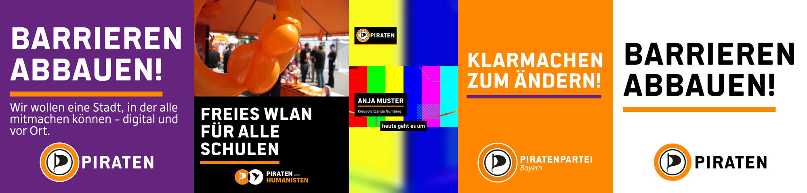
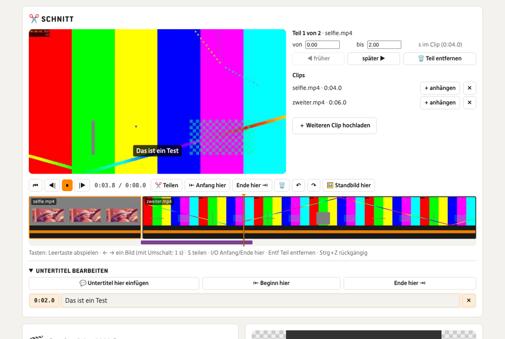
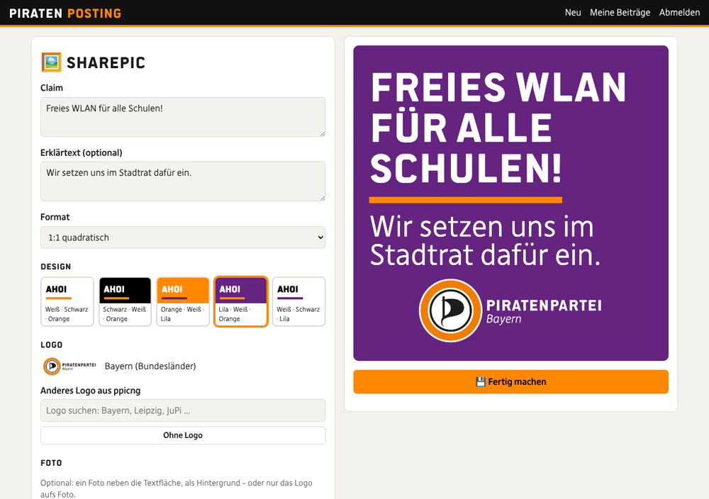

# Piraten-Posting-Bot

Ein Bot für einheitliches Design bei der Piratenpartei – **auch für Videos**. Video oder Foto in **Telegram** oder
**Matrix** (auch aus Räumen auf `matrix.piratenpartei.de`) reinschicken – oder in der **Web-Version** im Browser hochladen → es
entsteht im Design von [ppicng](https://github.com/Piratenpartei/ppicng) → Vorschau anpassen → als fertige Datei
holen oder direkt über [Postiz](https://postiz.com) posten bzw. planen. Postiz ist optional.

Damit nicht jede Gliederung ihr eigenes Kraut und Rüben baut, nimmt der Bot alles, was das Design ausmacht, direkt
aus ppicng – denselben Logos, Schriften und Farben wie die Sharepics aus der ppicng-Web-App:

| aus ppicng | im Bot |
|---|---|
| Logos aller Gliederungen, AGs, JuPis, Listen (`src/logos/logos.json`) samt heller/dunkler Variante | Logo-Plakette im Video, Logo auf Sharepics, Titelkarte und Abspann – Variante automatisch passend zum Hintergrund |
| Schriften Politics Head und DejaRip | Claim, Bauchbinde (Politics Head), Untertitel und Fließtext (DejaRip) |
| Farbschemata von „classic“ (Weiß·Schwarz·Orange, Lila·Weiß·Orange …) und die Linie unter dem Claim | Sharepics, Titelkarte, Abspann, Bauchbinde, Untertitel-Flächen |
| Layout von „classic“ (Claim eingepasst, Linie, Erklärtext, Logo unten, Foto daneben) | Sharepics und Karten im Video, nachgebaut mit Canvas (`src/grafik.mjs`) |

ppicng hängt als **Git-Submodul** in `ppicng/`. Kommt dort ein neues Logo dazu, holt `bash pi/aktualisieren.sh`
es mit. Wer eine eigene ppicng-Instanz mit weiteren Logos hat, trägt deren Pfad als `PPICNG_DIR` ein.



## Was der Bot kann

| Eingabe | Ergebnis |
|---|---|
| **Video** | im gewählten Format (Original, 9:16, 4:5, 1:1, 16:9; mit unscharfem Rand oder zugeschnitten), mit Logo-Plakette, Untertiteln (whisper.cpp, lokal), Bauchbinde, Titelkarte und Abspann |
| **`/sharepic Claim`** (Matrix: **`!sharepic Claim`**) | Sharepic wie aus ppicng; zweite Zeile = Erklärtext. Im Einzelchat bei Telegram reicht der Text allein |
| **Foto** | mit Bildunterschrift: Sharepic mit Foto (Foto neben/über der Textfläche oder als Hintergrund); ohne: Foto mit Logo |
| **`/logo Bayern`** | Logos aus ppicng suchen, mit ID für `.env` und `chats.json` |

Danach kommt die Vorschau und darunter das Menü:

| Knopf | |
|---|---|
| ✅ Jetzt posten · 🕐 Planen | nur mit Postiz: fragt nach und postet; Planen mit Vorschlägen, nächstem freien Postiz-Slot oder Eingabe wie `Fr 18 Uhr`, `24.10. 19:30`, `in 2 Stunden` |
| 📥 Fertige Datei | die Datei in voller Qualität – auch ganz ohne Postiz |
| 🎨 Gestaltung | Design, Logo, Format, 9:16-Fassung, Untertitel (an/aus, Lage, Fläche oder Kontur, bearbeiten als Liste), Bauchbinde, Titelkarte, Abspann; bei Sharepics Claim, Erklärtext und Foto-Stil. „Übernehmen“ baut neu |
| ✏️ Text ändern · 🔄 Neu formulieren | Beitragstext; neu formulieren nur mit KI-Schlüssel (Claude oder OpenAI) |
| 📺 Kanäle · 👤 Kunde | nur mit Postiz: Kanäle an-/abwählen, Postiz-Kunden (z. B. eine Gliederung) wählen |
| 🗑️ Verwerfen | |

Für **Titelkarte und Abspann** kann man statt Text auch ein eigenes Bild schicken – zum Beispiel ein Sharepic, das
man vorher in der ppicng-Web-App gebaut hat (`PPICNG_URL` setzen, dann verlinkt der Bot sie).

Untertitel bearbeiten: unter 📝 Untertitel → ✏️ Untertitel bearbeiten schickt der Bot alle Untertitel als
nummerierte Liste. Kopieren, Fehler ändern, zurückschicken – die Nummer bleibt vorne, die Zeiten bleiben gleich.
Es reichen auch nur die geänderten Zeilen (`4 Ob das klappt?`), `4 -` löscht Untertitel 4, `Pieraten => PIRATEN`
ersetzt überall; alternativ die korrigierte `.srt`-Datei schicken. Wiederkehrende Begriffe gehören ins
`glossar.txt`. (Wie im Stadtrat-Social-Bot.)

Ist ein Text für einen Kanal zu lang (X 280, Bluesky 300, Mastodon 500 …), lässt der Bot nicht posten und bietet
„✂️ Automatisch kürzen“ an. 15 Minuten nach jedem Termin schaut er in Postiz nach und meldet sich, wenn etwas hängt
oder ein Netzwerk abgelehnt hat.

## Zwei Wege: schnell im Chat, gründlich im Browser

- **Telegram/Matrix, wenn es schnell gehen soll:** Video reinschicken, der Bot setzt Logo, Untertitel und Design
  drauf, Vorschau ansehen, posten – fertig.
- **Web-Version, wenn geschnitten werden soll:** mehrere Clips, Anfang und Ende kürzen, Stellen herausschneiden,
  Reihenfolge ändern, Untertitel korrigieren, alles mit Vorschau. Unter jeder Vorschau im Chat steht
  **„✂️ Im Browser schneiden“** (wenn `WEB_URL` gesetzt ist): Der Link öffnet genau diesen Beitrag in der
  Web-Version. Er gilt einmal; danach gehört der Beitrag der Person, die ihn im Browser geöffnet hat, und
  verschwindet aus dem Chat-Menü.

## Web-Version

Wie ppicng, aber auch für Videos: Sharepic gestalten mit Live-Vorschau; Video hochladen und **schneiden**, Format,
Logo, Untertitel, Bauchbinde, Titelkarte und Abspann einstellen, Standbild-Vorschau ansehen, bauen, herunterladen –
und, wenn freigeschaltet, über Postiz posten. Sie läuft im selben Prozess wie der Bot und teilt sich dessen
Warteschlange; es geht aber auch ganz ohne Telegram und Matrix.

### Schneiden



- **Zeitleiste** mit Filmstreifen und Tonwelle je Teil; klicken oder ziehen springt, die violetten Balken darunter
  sind die Untertitel.
- **Abspielen wie geschnitten:** Der Player springt von Teil zu Teil und Clip zu Clip, die Untertitel laufen mit.
- **Teilen** an der Abspielposition, **Anfang/Ende hier** kürzt den Teil, **Teil entfernen**, **früher/später**
  verschiebt ihn, Anfang und Ende auch auf die Hundertstelsekunde als Zahl. **Rückgängig/Wiederholen** (100 Schritte).
- **Übergänge** je Schnitt: harter Schnitt, Überblendung, über Schwarz, über Weiß, Wischen, Schieben, Kreis –
  0,1 bis 2 Sekunden lang, auf Wunsch „für alle Schnitte“. Bild und Ton werden dabei überblendet; das Video wird
  um die Dauer der Übergänge kürzer. Im Player werden sie angedeutet, ganz echt im fertigen Video.
- **Lautstärke je Teil** (0–200 %) und **stumm** – etwa, um eine Stelle mit Störgeräusch leise zu machen oder nur
  Musik laufen zu lassen. An jedem Schnitt blendet der Ton ganz kurz, damit nichts knackt.
- **Mehrere Clips:** weitere Videos hochladen; jeder Clip lässt sich (auch mehrmals) ganz ans Ende hängen.
  Unterschiedliche Formate passen sich dem Zielformat an (Rand oder Zuschnitt, je Teil).
- **Untertitel bearbeiten:** Liste aller Untertitel im Schnitt – Text ändern, löschen, neue an der
  Abspielposition einfügen, Beginn und Ende auf die Abspielposition setzen. Die Untertitel hängen am Clip, nicht
  am Schnitt: Schneidet man später anders, bleiben sie an der richtigen Stelle.
- **🖼️ Standbild hier:** zeigt das Bild an der Abspielposition mit Logo, Untertiteln und Bauchbinde, wie es im
  fertigen Video aussieht.
- **Tasten:** Leertaste abspielen, ← → ein Bild (mit Umschalt 1 s), S teilen, I/O Anfang/Ende hier, Entf entfernen,
  Strg+Z / Strg+Y.

Fürs Abspielen im Browser legt der Bot je Clip eine kleine Arbeitskopie an (H.264, 854 px, dichte Keyframes für
genaues Springen) sowie Filmstreifen und Tonwelle. Gerendert wird aus den Originalen – trim, concat, Untertitel,
Logo und Bauchbinde in **einem** ffmpeg-Durchgang, damit der Pi nur einmal encodiert.

### Ton

- **Eigene Tonspur:** Unter dem Bild liegt der Ton als eigene Ebene mit Wellenform. Zuerst hängt er am Bild (jeder
  Teil bringt seinen Ton mit). Mit **🔓 Ton vom Bild lösen** – oder einfach durch Ziehen eines Tonabschnitts – wird er
  eigenständig: Abschnitte verschieben (J- und L-Schnitte, Ton läuft über den Schnitt hinaus), an den Rändern kürzen,
  mit Alt den Inhalt im Abschnitt verschieben, mit **S** teilen, mit **Entf** entfernen, je Abschnitt Lautstärke
  (bis 200 %), stumm, Ein- und Ausblenden. Abschnitte rasten an Schnitten, Abspielposition und anderen Abschnitten ein,
  überlappende werden gemischt. Der Player spielt die Tonspur genau so, wie sie im fertigen Video klingt; die
  Untertitel folgen dem hörbaren Ton. **🔗 Wieder ans Bild koppeln** verwirft die eigene Tonspur.
- **Tonaufnahme dazu** (z. B. Ansteckmikrofon, Zoom-Rekorder): Der Bot vergleicht die Lautstärkekurven mit dem Ton
  der Kamera, findet die passende Stelle (auf 10 ms genau) und ersetzt den Kamera-Ton an jedem Schnitt durch die
  Aufnahme – der Kamera-Ton bleibt stumm in der Spur, falls man ihn doch braucht. Die Untertitel kommen weiter aus
  dem Kamera-Clip. Findet er keine passende Stelle, liegt die Aufnahme ab 0:00 und lässt sich von Hand schieben
  (🎯 sucht erneut). Ohne Bezug zu einem Clip bekommt die Aufnahme eine eigene Spracherkennung.
- **Hintergrundmusik:** Audiodatei hochladen (MP3, M4A, OGG, WAV, FLAC). Sie läuft in Schleife unter dem Video,
  blendet am Anfang ein und am Ende aus, Lautstärke und Startpunkt im Stück sind einstellbar. Mit **„Leiser, wenn
  gesprochen wird“** (Ducking) geht sie automatisch zurück, sobald jemand redet. Im Player hört man sie zur
  Kontrolle mit, das Ducking erst im fertigen Video. Bitte nur Musik verwenden, die ihr nutzen dürft.
- **Lautstärke angleichen** (Standard an, `TON_ANGLEICHEN`): bringt das Video auf -16 LUFS, das Niveau, das
  Instagram, TikTok & Co. erwarten – leise Handyaufnahmen werden lauter, laute nicht übersteuert.
- **Rauschminderung** (`TON_RAUSCHMINDERUNG`): dämpft Wind und gleichmäßiges Rauschen.
- Auch im Chat: 🎨 Gestaltung → 🔊 Ton – angleichen, Rauschminderung, Musik als Audiodatei schicken,
  Musiklautstärke (leise/mittel/laut), Ducking.

### Anmeldung und Sicherheit



**Ohne Postiz braucht die Web-Version keine Anmeldung.** Jeder Browser bekommt dann automatisch eine eigene
Gast-Sitzung und sieht nur seine eigenen Projekte. **Ist Postiz eingerichtet, ist die Anmeldung Pflicht** –
ohne startet die Web-Version gar nicht, damit niemand Fremdes auf eure Kanäle posten kann:

```
WEB_PORT=8090
WEB_URL=https://posting.piraten-nuernberg.de
# Anmeldung mit dem eigenen Konto von matrix.piratenpartei.de …
WEB_MATRIX_ANMELDUNG=ja
WEB_ERLAUBT=*:piratenpartei.de
# … und/oder mit einem Team-Passwort (mindestens 12 Zeichen)
WEB_PASSWORT=
# Posten über Postiz nur für bestimmte Leute (oder ja = alle Angemeldeten)
WEB_POSTEN=@anja:piratenpartei.de,@bob:piratenpartei.de
```

- **Matrix-Anmeldung:** Erlaubt ist, wer in `WEB_ERLAUBT` passt (`*:piratenpartei.de` = alle mit Konto dort). Das
  Passwort geht nur einmal per https zur Prüfung an den Matrix-Server, der Bot speichert es nicht und meldet die dabei
  entstandene Sitzung sofort wieder ab. Fliegt jemand aus `WEB_ERLAUBT`, gilt seine Sitzung sofort nicht mehr.
- **Team-Passwort:** mindestens 12 Zeichen. Wird es geändert, sind alle damit angemeldeten Sitzungen sofort ungültig.
- **Posten** im Browser ist zusätzlich standardmäßig aus (`WEB_POSTEN=nein`): Anmelden heißt noch nicht posten
  dürfen. Am besten konkrete Personen eintragen. Herunterladen geht immer.
- **Sitzungen** liegen auf dem Server (nur als Hash, Datei nur für den Bot lesbar); im Cookie steht ein zufälliger
  Schlüssel – `HttpOnly`, `SameSite=Strict`, mit https-`WEB_URL` außerdem `Secure` mit `__Host-`-Präfix und HSTS.
  Abmelden löscht die Sitzung wirklich; eine Anmeldung ersetzt die alte Sitzung des Browsers.
- **Gegen Raten:** nach 10 Fehlversuchen je Adresse 15 Minuten Pause, zusätzlich höchstens 20 Fehlversuche je Name
  und Stunde.
- **Gegen fremde Seiten (CSRF):** Schreibende Anfragen brauchen einen eigenen Kopf, den nur die Seite selbst setzen
  kann, und einen passenden `Origin`. Strenge Content-Security-Policy, kein Einbetten in fremde Seiten.
- **Gegen präparierte Dateien:** ffmpeg liest Hochgeladenes nur mit einer Liste erlaubter Formate und nur als lokale
  Datei. Als Video getarnte Playlists (HLS, Concat), die Dateien des Servers einbinden wollen, werden abgelehnt;
  gespeichert wird nur mit bekannten Endungen. Dateipfade kommen nie aus dem Browser.
- **Gegen Missbrauch der Rechenzeit:** höchstens `WEB_UPLOADS_PRO_STUNDE` Uploads je Adresse, `WEB_MAX_MB` je Datei,
  `WEB_MAX_MINUTEN` Videolänge, `WEB_OFFENE_PROJEKTE` je Person und zwei laufende Aufträge gleichzeitig, und
  insgesamt höchstens `WEB_MAX_SPEICHER_GB`. Gerade im offenen Modus wichtig – wer die Seite öffentlich ins Netz stellt,
  stellt Rechenzeit zur Verfügung; im Zweifel trotzdem ein Team-Passwort setzen.
- **Protokoll:** Anmeldungen (auch fehlgeschlagene), Abmeldungen, Übernahmen und jedes Posten mit Person, Adresse und
  Kanälen stehen in `daten/web-protokoll.log`. Interne Fehler zeigen nach außen nur eine Nummer, Details nur im Log.
- **HTTPS:** Die Web-Version lauscht standardmäßig nur auf `127.0.0.1`. Davor gehört ein Reverse-Proxy mit HTTPS,
  Vorlage für nginx: `pi/nginx.conf` (Umleitung auf https, echte Adresse der Besucher, große Uploads durchreichen).
  Nur dann wird `X-Real-IP` geglaubt (`WEB_PROXY`).
- **Jede Person sieht nur ihre eigenen Beiträge** (beim Team-Passwort: alle mit demselben Namen).
- Die Seite kommt ohne fremde Server aus (keine CDNs, keine Tracker), Schriften und Logos liefert der Bot selbst.

## Gesicht und Untertitel

Bei Hochkant-Videos sucht der Bot in 12 Bildern das Gesicht (OpenCV, lokal, ein paar Sekunden) und legt die
Untertitel dorthin, wo sie es nicht verdecken – bevorzugt unten, sonst oben, sonst in der Mitte („📍 Lage:
automatisch“, im Menü bzw. in der Web-Version überschreibbar). Weil das Video vorher ins Zielformat gesetzt wird
(z. B. ein Querformat-Video mit Rand in 9:16), rechnet der Bot die Lage des Gesichts erst auf das fertige Bild
um. Füllt das Gesicht fast das ganze Bild oder reicht der Kopf ins Logo, gibt es einen 💡-Tipp für die nächste
Aufnahme. `pi/install.sh` richtet Python mit OpenCV in `.venv` ein; fehlt es, bleibt die Suche einfach aus.
Übernommen aus dem [Stadtrat-Social-Bot](https://github.com/vwt1812-glitch/stadtrat-social-bot).

## Querformat → 9:16 für Instagram, TikTok und Story

Querformat-Videos laufen auf X, Mastodon, Bluesky oder Facebook gut, auf Instagram und TikTok braucht es Hochformat.
Mit **📲 9:16 für Insta** (im Bot unter 🎨 Gestaltung, im Browser unter „Fassungen“) baut der Bot zusätzlich eine
9:16-Fassung: das Video in voller Breite, darüber und darunter eine unscharfe Kopie. In diesem Rand sitzt das Logo
über dem Bild, die Untertitel stehen darunter („📍 Lage: direkt unter dem Bild“) und die Bauchbinde bleibt im Bild – so
verdeckt nichts das Gesicht. Beim Posten über Postiz bekommen nur die Hochformat-Netzwerke (`HOCHKANT_NETZE`,
Standard Instagram und TikTok) die 9:16-Fassung, alle anderen das Original.

**📱 Story** postet zusätzlich eine Instagram-Story – mit der 9:16-Fassung, bei Sharepics in 9:16 neu gesetzt. Beide
Fassungen gibt es auch als Download. Übernommen aus dem
[Stadtrat-Social-Bot](https://github.com/vwt1812-glitch/stadtrat-social-bot).

## Telegram und Matrix

Beide laufen gleichzeitig, wenn beide eingetragen sind; mindestens eins davon oder die Web-Version muss es sein.

### Telegram

1. **@BotFather** → `/newbot` → Token als `TELEGRAM_BOT_TOKEN` eintragen.
2. Dem Bot `/id` schicken, die ID in `TELEGRAM_ERLAUBT` eintragen. Für Gruppen: Bot einladen, bei @BotFather
   `/setprivacy` → **Disable**, in der Gruppe `/id` schicken und die (negative) Gruppen-ID eintragen – dann dürfen
   alle in der Gruppe.
3. Videos am besten **als Datei** schicken (📎 → Datei), sonst komprimiert Telegram sie. Über `api.telegram.org`
   gehen nur 20 MB herunter und 50 MB hoch; für größere Videos einen lokalen
   [Bot-API-Server](https://github.com/tdlib/telegram-bot-api) betreiben und `TELEGRAM_API_URL` setzen (wie im
   [Stadtrat-Bot](https://github.com/vwt1812-glitch/stadtrat-social-bot#große-videos-über-20-mb) beschrieben).

### Matrix

Auf matrix.piratenpartei.de kann man nicht einfach selbst Konten anlegen. Das Bot-Konto kommt deshalb auf einen
anderen Server – etwa **matrix.org** (Registrierung offen, z. B. über [app.element.io](https://app.element.io)) oder
einen eigenen. Über die Föderation lädt man den Bot trotzdem in Räume auf matrix.piratenpartei.de ein und
schreibt ihm von dort; benutzen dürfen ihn weiterhin nur die Leute aus `MATRIX_ERLAUBT`.

1. Ein Konto für den Bot anlegen, z. B. `@posting-bot:matrix.org`.
2. In `.env`: `MATRIX_NUTZER=@posting-bot:matrix.org` + `MATRIX_PASSWORT` – der Bot findet den Server selbst
   (`/.well-known/matrix/client`) und meldet sich an. Oder `MATRIX_URL=https://matrix-client.matrix.org` plus
   `MATRIX_TOKEN` (Element → Einstellungen → Hilfe & Info → Zugriffstoken).
3. `MATRIX_ERLAUBT`: die Leute, nicht der Server des Bots – Personen (`@anja:piratenpartei.de`), Räume
   (`!abc…:piratenpartei.de`) oder alle auf einem Server (`*:piratenpartei.de`). **Nicht** `*:matrix.org`, sonst
   darf jede:r mit Konto dort (der Bot warnt beim Start). Einladungen von Erlaubten nimmt der Bot selbst an.
4. Den Bot in einen Raum einladen oder direkt anschreiben (Element: „Direktnachricht starten“ →
   `@posting-bot:matrix.org`).

**Föderation:** Der Raum darf nicht auf „Nur Mitglieder von piratenpartei.de“ stehen (diese Einstellung lässt sich
nur beim Anlegen wählen) und keine Server-ACL haben, die den Server des Bots aussperrt. Sonst klappt der Beitritt
nicht – der Bot schreibt das ins Log. Dann einen neuen Raum für den Bot anlegen. Videos und Bilder gehen über die
Föderation hin und her; die Größengrenze für Uploads liest der Bot vom eigenen Server.

Matrix kennt keine Knöpfe. Der Bot schreibt die Auswahl deshalb nummeriert unter seine Nachricht und setzt die
Reaktionen **1️⃣ 2️⃣ 3️⃣ …** gleich selbst darunter – antippen genügt. Man kann auch einfach die Zahl schicken.
Ein neues Menü ersetzt das alte, damit der Raum übersichtlich bleibt. Befehle in Matrix mit `!` statt `/`
(`!sharepic`, `!logo`, `!status`), weil Element `/…` als eigenen Befehl versteht.

**Ratenlimit:** Synapse bremst Konten, die viele Nachrichten schnell hintereinander schicken – der Bot setzt pro
Menü bis zu zehn Reaktionen. Er wartet dann selbst. Auf einem eigenen Server geht es schneller, wenn man das
Bot-Konto vom Limit ausnimmt (Admin-API `/_synapse/admin/v1/users/<id>/override_ratelimit`); auf matrix.org geht
das nicht, da dauert ein Menü mitunter ein paar Sekunden.

**Verschlüsselung:** Der Bot liest keine Ende-zu-Ende-verschlüsselten Räume (und sagt das auch). Für den Bot einen
unverschlüsselten Raum nehmen – bei neuen Räumen und Direktnachrichten in Element vor dem Anlegen
„Ende-zu-Ende-Verschlüsselung“ ausschalten. Wer Verschlüsselung braucht, setzt
[pantalaimon](https://github.com/matrix-org/pantalaimon) davor und trägt dessen Adresse als `MATRIX_URL` ein.

## Ohne und mit Postiz

Ohne `POSTIZ_URL` ist der Bot ein reines Design-Werkzeug: Er baut Videos und Sharepics, und mit **📥 Fertige Datei**
holt man sie ab. Mit `AUSGABE_ORDNER` landen alle fertigen Dateien zusätzlich in einem Ordner, etwa einem
Nextcloud-Sync-Ordner des Social-Media-Teams.

Mit Postiz: In Postiz **Einstellungen → Developers → Public API** den Schlüssel holen, `POSTIZ_URL` und
`POSTIZ_API_KEY` eintragen. Die Kanäle ordnet man in Postiz Kunden zu (z. B. „KV Nürnberg“, „LV Bayern“); der Bot
liest sie von dort. Postiz erlaubt standardmäßig 30 API-Anfragen pro Stunde, der Bot zählt mit
(`POSTIZ_MAX_ANFRAGEN`). Einstellungen je Netzwerk (Pinterest-Board, TikTok-Sichtbarkeit, eigene Zeichenlimits)
kommen in `kanaele.json` (Vorlage: `kanaele.example.json`). `/kanaele` listet alle Kanäle mit IDs.

## Ein Bot für mehrere Gliederungen

Voreinstellungen je Telegram-Chat oder Matrix-Raum stehen in `chats.json` (Vorlage: `chats.example.json`): Logo,
Design, Bauchbinde, Absender für die KI-Texte, Hashtags und Postiz-Kunde. So kann ein Bot auf einem Server viele
Gliederungen bedienen – jede bekommt im eigenen Raum ihr Logo, alle dasselbe Design.

```json
{
  "!abcdefghijklmn:piratenpartei.de": {
    "logo": "laender/bayern",
    "design": "schwarz-weiss-orange",
    "absender": "Piratenpartei Bayern",
    "hashtags": "#Bayern #Piraten",
    "postizKunde": "LV Bayern"
  }
}
```

## Einrichten (Raspberry Pi oder Server)

Getestet mit Node.js 22 und ffmpeg auf Debian/Raspberry Pi OS (64 Bit). Ein Pi 5 ist für Videos empfehlenswert,
ein Pi 4 geht, braucht aber länger. Ohne Spracherkennung reicht deutlich weniger.

```bash
git clone --recurse-submodules https://github.com/vwt1812-glitch/piraten-posting-bot.git
cd piraten-posting-bot
bash pi/install.sh             # ffmpeg, Node.js, ppicng, whisper.cpp samt Modell, .env, Dienst
nano .env                      # Telegram, Matrix und/oder Web-Version, optional Postiz und KI
sudo systemctl start posting-bot
```

`OHNE_WHISPER=1` lässt die Spracherkennung weg, `OHNE_GESICHT=1` die Gesichtssuche, `WHISPER_GROESSE=base` nimmt ein kleineres
Modell. Danach dem Bot `/status` (Matrix: `!status`) schicken: zeigt ffmpeg, ppicng-Stand, Whisper, Postiz und KI.

| Befehl | |
|---|---|
| `journalctl -u posting-bot -f` | Protokoll ansehen |
| `sudo systemctl restart posting-bot` | neu starten, z. B. nach Änderungen an `.env` |
| `bash pi/aktualisieren.sh` | neuen Code und neue ppicng-Logos holen, neu starten |
| `npm run sharepic -- "Claim" --design lila-weiss-orange --logo laender/bayern --format 4:5` | Sharepic ohne Bot bauen, zum Ausprobieren |
| `npm test` | Tests (inkl. Ende-zu-Ende-Läufen gegen nachgebaute Telegram-, Matrix- und Postiz-Server und über die Web-API) |

## Gestaltung im Video

- **Logo** oben links (`LOGO_POSITION`), standardmäßig ohne Fläche (`LOGO_STIL=auto`): Der Bot misst, wie hell
  das Bild hinter dem Logo ist, und nimmt auf hellem Grund (weiße Wand) das dunkle Logo mit hellem Schein, sonst
  das helle mit Schatten. `plakette` setzt es auf eine kleine, abgerundete Fläche im Design mit der farbigen Linie
  darunter (wie unter dem Claim in ppicng), `glas` auf dunkles Milchglas (der Hintergrund dahinter wird
  weichgezeichnet und abgedunkelt) mit hellem Logo, `frei` immer hell mit Schatten. Umschaltbar im Bot unter 🏴‍☠️ Logo →
  ✨ Stil und im Browser. Hochkant beginnt das Logo bei 14 % der Höhe, frei von den Reitern von Reels und TikTok.
- **Untertitel** in DejaRip Bold auf einer Fläche im Design (`UNTERTITEL_STIL=box`) oder weiß mit Kontur (`rand`),
  einzeilig in kurzen Häppchen; hochkant über Name und Caption der Apps, pro Video unten/Mitte/oben.
- **Bauchbinde**: Name in Politics Head mit Linie, Funktion in DejaRip; gleitet nach `BAUCHBINDE_START` Sekunden
  herein und verdeckt die Untertitel nicht.
- **Titelkarte und Abspann**: Karten im ppicng-Layout (Claim, Linie, Logo), weich überblendet; die Länge stellen
  `TITELKARTE_DAUER` und `ABSPANN_DAUER` ein.

## Aufbau

| Datei | Inhalt |
|---|---|
| `src/bot.mjs` | Start; Ablauf im Chat: Eingang, Menüs bedienen, posten, Kontrolle |
| `src/werkstatt.mjs` | gemeinsam für Bot und Web: Aufträge, Clips, Schnitt, Untertitel, Analyse, Bauen, Standbild, Postiz, Warteschlange |
| `src/schnitt.mjs` | Schnittliste prüfen (inkl. Übergänge, Lautstärke je Teil), Zeiten zwischen Clip und fertigem Video umrechnen, Untertitel mitnehmen |
| `src/web.mjs` · `web/` | Web-Version: HTTP-API (Anmeldung, Upload, Vorschau, Bauen, Posten) und Seite ohne Build-Schritt |
| `src/websicherheit.mjs` | Sitzungen, Begrenzungen, Absenderadresse hinter dem Proxy, Sicherheitsprotokoll |
| `src/gesicht.mjs` · `src/gesicht.py` | Gesicht finden (OpenCV), aufs Zielformat umrechnen, Lage der Untertitel wählen |
| `src/plattform/telegram.mjs` | Telegram Bot API, Knöpfe |
| `src/plattform/matrix.mjs` | Matrix Client-Server-API ohne SDK: Sync, Einladungen, Medien, Menüs mit Reaktionen |
| `src/menues.mjs` | Texte und Knöpfe aller Menüs (für beide Plattformen gleich) |
| `src/ppicng.mjs` | ppicng einlesen: Logos samt Varianten, Schriften, Farbschemata, Logosuche |
| `src/grafik.mjs` | Sharepic, Logo-Plakette, Bauchbinde, Titelkarte im ppicng-Layout (Canvas) |
| `src/video.mjs` | ffmpeg: Schnitt (trim, concat bzw. xfade), Ton (Lautstärke, Musik, Ducking, Lautheit, Rauschminderung), Format, Untertitel, Logo, Bauchbinde, Karten; Arbeitskopien; sichere Eingänge |
| `src/untertitel.mjs` · `src/whisper.mjs` | SRT/ASS, Korrekturen, Spracherkennung mit whisper.cpp |
| `src/caption.mjs` | Beitragstext (Claude, OpenAI oder einfacher Vorschlag), Kürzen |
| `src/postiz.mjs` · `src/kontrolle.mjs` | Postiz Public API, Zeichenzählung, Anfragenlimit, Kontrolle nach dem Posten |
| `src/zeit.mjs` · `src/auftraege.mjs` | Zeitangaben verstehen; Stand je Beitrag in `daten/auftraege.json` (nach 14 Tagen aufgeräumt) |

Untertitel, Caption, Postiz, Kontrolle, Zeitangaben und die Pi-Skripte stammen aus dem
[Stadtrat-Social-Bot](https://github.com/vwt1812-glitch/stadtrat-social-bot) und
[eu-piraten-abstimmungen](https://github.com/vwt1812-glitch/eu-piraten-abstimmungen).

## Lizenzen

Logos, Schriften und Designs gehören zu ppicng bzw. der Piratenpartei und liegen nicht in diesem Repository (außer im Beispielbild `docs/beispiele.png`),
sondern kommen über das Submodul. Der Code von ppicng steht unter der MIT-Lizenz (Martin Stoppler).
